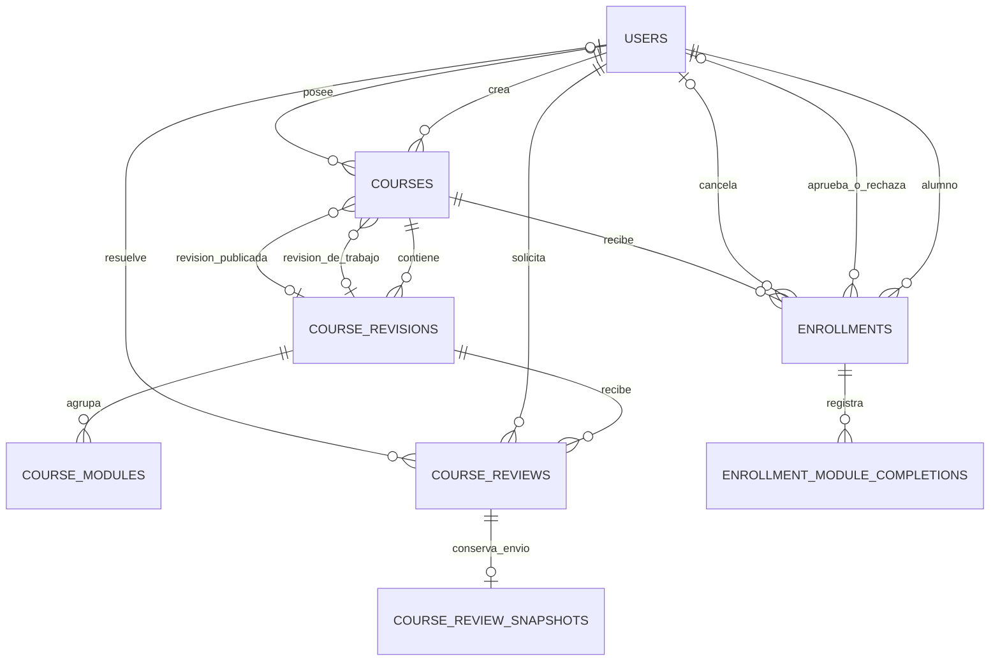

# Modelo de datos de LUMEN

Este DER técnico describe el esquema vigente de SQLite, generado por EF Core. No reemplaza la consigna académica ni introduce nuevas reglas de negocio.



| Tabla | Clave e invariantes |
|---|---|
| `Users` | PK `Id`; índice único de `NormalizedEmail`. |
| `Courses` | PK `Id`; creador obligatorio, propietario opcional. `WorkingRevisionId` y `PublishedRevisionId` son FK opcionales e independientes. Los disparadores exigen que los punteros nuevos o actualizados pertenezcan al propio curso. |
| `CourseRevisions` | PK `Id`; `(CourseId, Version)` único. |
| `CourseModules` | PK `(RevisionId, Id)`; `(RevisionId, Order)` único. |
| `CourseReviews` | PK `Id`; revisión y solicitante obligatorios, revisor opcional. |
| `CourseReviewSnapshots` | PK y FK `ReviewId`; copia JSON independiente de la revisión editable. Los disparadores impiden actualizar, borrar o reemplazar la evidencia de un envío existente. |
| `Enrollments` | PK `Id`; alumno y curso obligatorios. Índice único parcial sobre `(StudentId, CourseId)` para los estados `Pendiente` y `Aprobada`. `ResolutionReason` conserva el motivo del rechazo automático al finalizar. Solo las aprobadas ocupan cupo. |
| `EnrollmentModuleCompletions` | PK `(EnrollmentId, ModuleId)`. Solo `EnrollmentId` es FK. El repositorio condiciona el alta del módulo a la publicación vigente. |

La tercera migración valida la pertenencia de los punteros en escrituras y protege el curso de una revisión referenciada. Conserva las filas existentes. Esta consulta de solo lectura detecta inconsistencias históricas para revisión:

```sql
SELECT c.Id, c.WorkingRevisionId, c.PublishedRevisionId
FROM Courses AS c
LEFT JOIN CourseRevisions AS w ON w.Id = c.WorkingRevisionId
LEFT JOIN CourseRevisions AS p ON p.Id = c.PublishedRevisionId
WHERE (c.WorkingRevisionId IS NOT NULL AND (w.Id IS NULL OR w.CourseId <> c.Id))
   OR (c.PublishedRevisionId IS NOT NULL AND (p.Id IS NULL OR p.CourseId <> c.Id));
```

Los módulos se identifican por `(RevisionId, Id)`. Al preparar una edición, un módulo que coincide con la publicación conserva su ID si mantiene nombre, descripción, duración, contenido y recursos. Reordenarlo conserva el avance. Cambiar esos datos da lugar a otro ID. Los módulos nuevos reciben otro ID y los retirados dejan de participar en el cálculo. Los completados históricos quedan en su inscripción y no se reasignan al republicar. Los datos anteriores que ya compartían IDs se conservan sin inferir equivalencias retroactivas.

La cuarta migración agrega evidencia únicamente para envíos nuevos y no deriva copias de revisiones mutables anteriores. La tabla conserva las copias de cada envío aunque se soliciten cambios y se edite la misma revisión de trabajo.

La quinta migración impide la sustitución mediante `INSERT OR REPLACE`, que con disparadores recursivos desactivados puede omitir el disparador de borrado. Se aplica sin modificar las filas. [Resolución de conflictos en SQLite](https://www.sqlite.org/lang_conflict.html).

La sexta migración agrega `ResolutionReason` sin modificar las inscripciones existentes. Los disparadores impiden reducir un cupo bajo la ocupación aprobada y publicar una revisión cuyo cupo no alcance. La aprobación de una solicitud comprueba el cupo en su sentencia de actualización. La finalización rechaza todas las pendientes y guarda el motivo en una sola transacción.

Fuentes: [configuraciones de EF Core](DataAccess/Configurations), [migraciones](Migrations/DatabaseMigrations) y [snapshot del modelo](Migrations/DatabaseMigrations/LumenDbContextModelSnapshot.cs).
