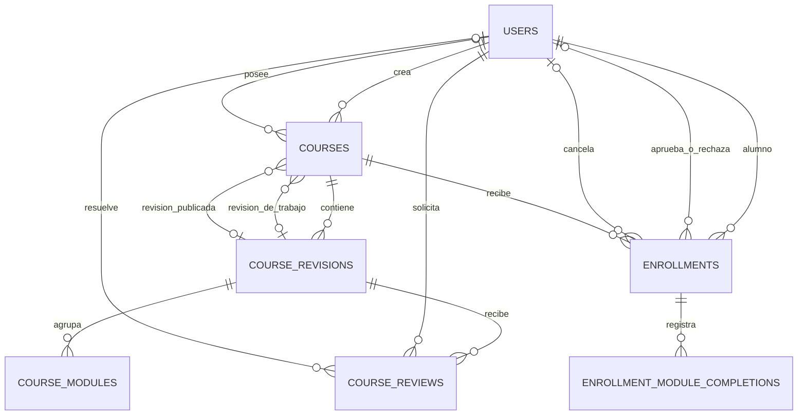

# Modelo de datos de LUMEN

Este DER técnico describe el esquema vigente de SQLite, generado por EF Core. No reemplaza la consigna académica ni introduce nuevas reglas de negocio.



| Tabla | Clave e invariantes |
|---|---|
| `Users` | PK `Id`; índice único de `NormalizedEmail`. |
| `Courses` | PK `Id`; creador obligatorio, propietario opcional. `WorkingRevisionId` y `PublishedRevisionId` son FK opcionales e independientes. Los disparadores exigen que los punteros nuevos o actualizados pertenezcan al propio curso. |
| `CourseRevisions` | PK `Id`; `(CourseId, Version)` único. |
| `CourseModules` | PK `(RevisionId, Id)`; `(RevisionId, Order)` único. |
| `CourseReviews` | PK `Id`; revisión y solicitante obligatorios, revisor opcional. |
| `Enrollments` | PK `Id`; alumno y curso obligatorios. Índice único parcial sobre `(StudentId, CourseId)` para los estados `Pendiente` y `Aprobada`. |
| `EnrollmentModuleCompletions` | PK `(EnrollmentId, ModuleId)`. Solo `EnrollmentId` es FK. El repositorio condiciona el alta del módulo a la publicación vigente. |

La tercera migración valida la pertenencia de los punteros en escrituras y protege el curso de una revisión referenciada. Conserva las filas existentes. Esta consulta de solo lectura detecta inconsistencias históricas para revisión:

```sql
SELECT c.Id, c.WorkingRevisionId, c.PublishedRevisionId
FROM Courses AS c
LEFT JOIN CourseRevisions AS w ON w.Id = c.WorkingRevisionId
LEFT JOIN CourseRevisions AS p ON p.Id = c.PublishedRevisionId
WHERE (c.WorkingRevisionId IS NOT NULL AND (w.Id IS NULL OR w.CourseId <> c.Id))
   OR (c.PublishedRevisionId IS NOT NULL AND (p.Id IS NULL OR p.CourseId <> c.Id));
```

Los módulos se identifican dentro de una revisión. El avance se calcula sobre los IDs presentes en la publicación vigente. Los completados históricos pueden seguir almacenados después de una republicación. Una referencia relacional adicional para completados requiere acordar qué identidad se conserva entre versiones.

Fuentes: [configuraciones de EF Core](DataAccess/Configurations), [migraciones](Migrations/DatabaseMigrations) y [snapshot del modelo](Migrations/DatabaseMigrations/LumenDbContextModelSnapshot.cs).
